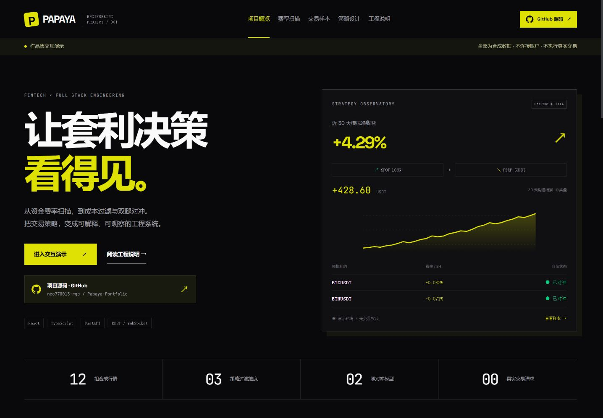
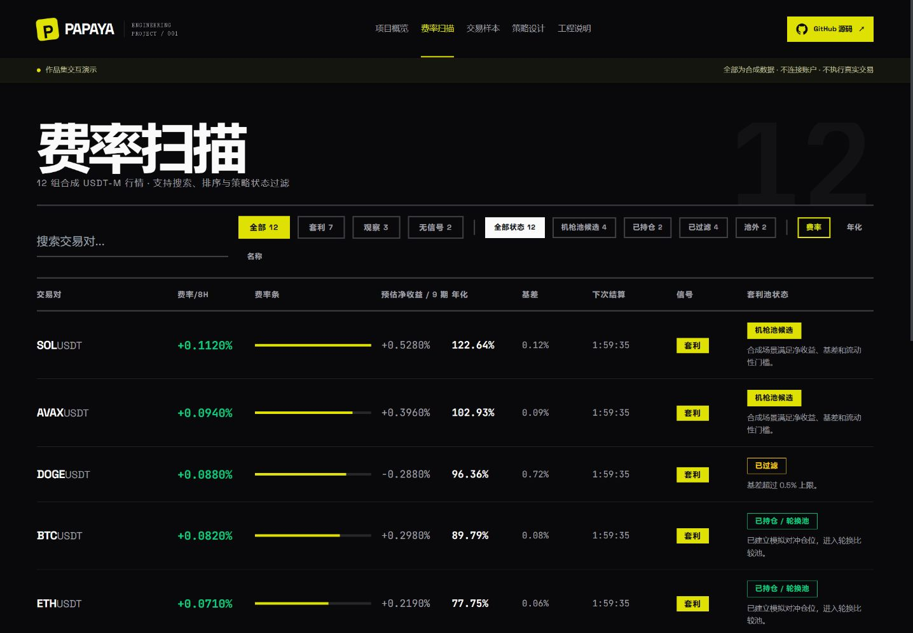
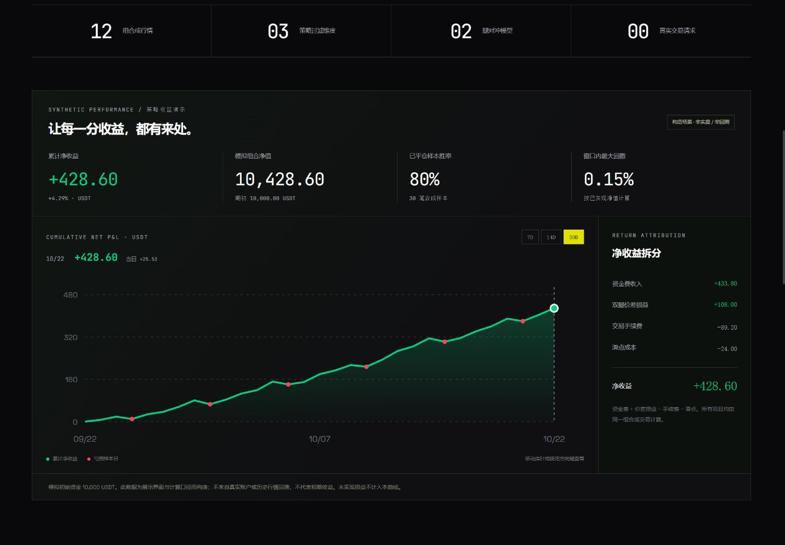
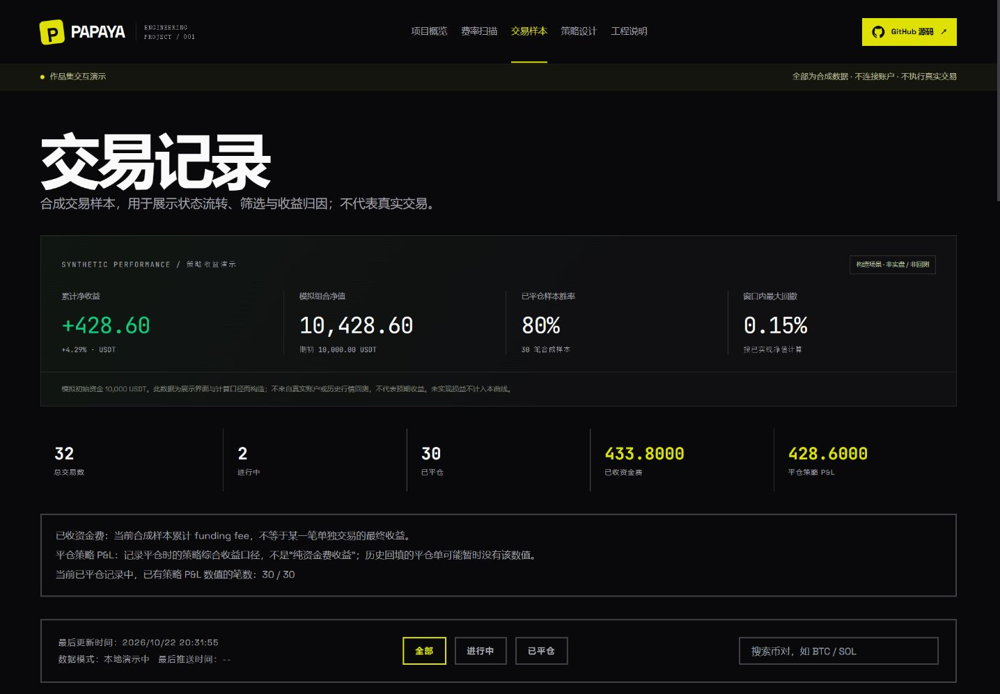
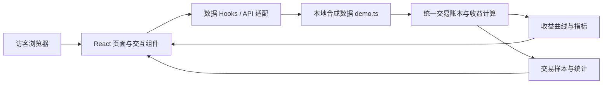

# Papaya · 资金费率套利系统作品集

**让套利决策看得见：从行情扫描、成本过滤，到收益归因与策略解释。**

[在线体验](https://papaya-arbitrage-portfolio.alylwxy.chatgpt.site/) · [费率扫描](https://papaya-arbitrage-portfolio.alylwxy.chatgpt.site/#/scanner) · [工程说明](https://papaya-arbitrage-portfolio.alylwxy.chatgpt.site/#/project) · [作者 @neo770013-rgb](https://github.com/neo770013-rgb)

Papaya 是一个围绕资金费率套利设计的工程作品。本仓库提供可直接运行的中文交互演示前端，用于展示数据建模、策略可视化、组件设计与工程边界。访客无需登录、安装软件或配置交易所密钥，即可在浏览器中体验主要页面。

> **演示数据说明**：行情、持仓、交易样本和收益曲线均为合成数据，不来自真实账户或历史行情回测，不代表实盘业绩或预期收益。本站不连接账户、不收集密钥、不执行真实交易。

[](https://papaya-arbitrage-portfolio.alylwxy.chatgpt.site/)

## 快速了解

| 关注点 | 本项目的实现 |
| --- | --- |
| 解决的问题 | 将资金费率、交易成本、候选过滤和仓位状态组织成可解释的界面 |
| 主要交互 | 搜索与排序、信号及候选池筛选、收益窗口切换、交易状态筛选、场景计算 |
| 数据规模 | 12 组合成行情、2 笔进行中仓位、30 笔已平仓合成样本 |
| 公开版本 | React + TypeScript 静态前端，演示数据在浏览器内生成 |
| 代码入口 | [数据与计算](src/lib/demo.ts)、[收益面板](src/components/PerformancePanel.tsx)、[回归测试](tests/) |

**建议体验顺序**：首页了解背景 → 费率扫描搜索 `BTC` 或筛选「已过滤」→ 查看交易样本 → 返回首页切换收益窗口与场景参数 → 阅读工程说明。

## 项目背景

资金费率套利通常会通过「现货做多 + 永续合约做空」构造对冲组合，在特定条件下获取资金费收入。但表面费率高，并不意味着扣除手续费、滑点和基差风险后仍有足够收益；双腿执行与仓位轮换也存在独立的工程问题。

Papaya 尝试把这些判断呈现出来：**为什么某个标的进入候选池，为什么另一个被过滤，收益由哪些部分组成，以及系统有哪些执行与安全边界。** 公开演示侧重可解释性和可浏览性，便于招聘者与开发者从页面效果进一步阅读实现。

## 页面与功能展示

### 1. 费率扫描：从行情到候选池

[打开费率扫描](https://papaya-arbitrage-portfolio.alylwxy.chatgpt.site/#/scanner)

- 展示 12 组 USDT-M 合成行情，包括资金费率、年化展示值、基差、预估净收益和结算倒计时。
- 支持交易对搜索，以及按费率绝对值、年化或名称排序。
- 支持套利、观察、无信号，以及候选、已持仓、已过滤、池外等状态筛选。
- 展示具体过滤原因，例如基差超限、流动性不足、资金费率为负或收益不足以覆盖成本。



### 2. 模拟收益：曲线与账本使用同一套口径

[打开首页收益展示](https://papaya-arbitrage-portfolio.alylwxy.chatgpt.site/)

- 支持 7 / 14 / 30 天窗口切换，展示累计净收益、模拟组合净值、已平仓样本胜率和窗口内最大回撤。
- 曲线保留亏损样本日，支持指针交互和方向键逐日查看。
- 将净收益拆分为资金费收入、双腿价差损益、交易手续费和滑点成本。
- 收益面板与交易记录共用合成交易账本；未实现损益不计入已实现净收益曲线。



截图中的 `+4.29%`、`80%` 等数值仅是构造场景的计算结果，用于展示指标与交互，不是项目的投资业绩。回撤按**已实现净值**计算，不覆盖真实账户中的盘中波动、保证金压力或未实现亏损。

### 3. 交易样本：观察状态与收益归因

[打开交易样本](https://papaya-arbitrage-portfolio.alylwxy.chatgpt.site/#/trade-history)

- 汇总进行中与已平仓样本，支持币对搜索、状态筛选和按需加载。
- 展示现货与期货数量、入场资金费率、开仓名义价值、开平仓时间与退出原因。
- 区分已收资金费和已平仓策略综合收益；进行中仓位不显示已实现收益。



### 4. 策略与工程说明：解释模型和取舍

[策略设计](https://papaya-arbitrage-portfolio.alylwxy.chatgpt.site/#/strategy) · [工程说明](https://papaya-arbitrage-portfolio.alylwxy.chatgpt.site/#/project)

策略页解释候选排序、成本模型、仓位约束和轮换门槛；首页提供「正常费率 / 基差扩大 / 费率转负」场景切换与持有期数调节，帮助理解高费率为什么不一定值得入场。

工程说明页介绍原系统的 API、状态存储和执行层设计，并明确静态展示版本的职责。网站采用深色背景、黄色交互强调和等宽数字排版，在桌面与移动端提供导航及 GitHub 源码入口。

## 工程设计亮点

| 设计问题 | 实现与取舍 |
| --- | --- |
| 指标容易前后不一致 | 曲线、胜率、汇总与交易记录从统一的合成账本计算，并以回归测试校验 |
| 高费率容易掩盖成本 | 同时展示费率、预估净收益与过滤原因，用场景计算解释费用及基差影响 |
| 展示站依赖外部服务会影响体验 | 使用本地合成场景，数据展示不依赖交易所接口或账户服务 |
| 招聘者需要快速理解项目 | 首页导览、交互模块、工程说明与公开源码相互链接 |
| 公开展示需要控制数据范围 | 将静态演示与原账户 API、交易执行器及运行历史分离 |

## 技术栈与架构

| 层次 | 技术与用途 |
| --- | --- |
| 界面与类型 | React 18、TypeScript |
| 路由 | React Router 6、HashRouter，便于静态托管与子页面分享 |
| 样式 | Tailwind CSS、自定义 CSS 与响应式布局 |
| 构建 | Vite 6、TypeScript 编译检查 |
| 数据 | 浏览器内合成数据、演示 API 适配与统一收益计算 |
| 测试 | Node.js 内置测试运行器、断言与 TypeScript 模块转译 |
| 部署 | 构建为 `dist/` 静态资源，无需账户 API 或常驻后端服务 |



**原系统与本仓库的关系**：原系统涉及 FastAPI、状态存储、HTTP / WebSocket、操作者认证和测试网双腿执行。它们作为工程背景在网站中介绍；本公开仓库只提供静态演示前端，不包含上述后端服务或交易执行器。克隆本仓库即可运行演示，无需访问原私有项目。

## 代码导览

```text
src/
├── App.tsx                         路由、导航与演示边界提示
├── components/
│   ├── GitHubLink.tsx              项目源码入口
│   └── PerformancePanel.tsx        收益曲线、窗口切换与归因面板
├── hooks/                         页面数据读取与状态封装
├── lib/
│   ├── api.ts                     数据接口与类型
│   ├── demo.ts                    合成行情、交易账本与收益计算
│   └── project.ts                 在线演示与 GitHub 地址
└── pages/
    ├── Home.tsx                   项目概览与场景计算器
    ├── Scanner.tsx                行情搜索、排序和候选过滤
    ├── TradeHistory.tsx           交易样本与收益口径说明
    ├── Strategy.tsx               策略设计与参数解释
    └── Settings.tsx               工程说明页面
tests/                             演示边界与数据一致性回归测试
docs/images/                       README 使用的网站截图
```

建议先读 [`src/lib/demo.ts`](src/lib/demo.ts)，理解数据与指标的来源，再读 [`PerformancePanel.tsx`](src/components/PerformancePanel.tsx) 和 [`Scanner.tsx`](src/pages/Scanner.tsx)，最后通过 [`tests/`](tests/) 查看一致性约束。

## 本地运行

建议使用 Node.js 22 LTS 和 npm。无需 Python、数据库、交易所账户或 `.env` 配置。

```bash
git clone https://github.com/neo770013-rgb/Papaya-Portfolio.git
cd Papaya-Portfolio
npm ci
npm run dev
```

默认开发地址：<http://127.0.0.1:5174/>。如果端口被占用，以终端实际输出为准。

| 命令 | 用途 |
| --- | --- |
| `npm run dev` | 启动本地开发服务 |
| `npm test` | 运行演示数据与边界回归测试 |
| `npm run build` | 进行 TypeScript 编译检查并生成 `dist/` |
| `npm run preview` | 在本地预览构建结果，地址以终端输出为准 |

## 测试与数据一致性

当前回归测试包含 3 组检查，重点验证以下约束：

- **演示数据无需交易后端**：禁用网络请求后，演示适配层仍能返回状态、候选池、日志和交易历史。
- **真实操作被拒绝**：演示适配层对平仓、自动止盈设置、认证检查及未知地址返回拒绝响应。
- **数据前后一致**：候选净收益等于毛收益减去总成本，仓位数量与候选池汇总一致，交易记录总额与汇总一致。
- **收益窗口可核对**：7 / 14 / 30 天窗口分别检查曲线终点、每日收益累加、资金费与成本拆分、组合净值，以及亏损样本和回撤的存在。

这些测试验证静态演示的数据逻辑与操作边界，不作为真实交易执行正确性、实盘风险控制或完整浏览器端到端测试的证明。

## 部署与二次使用

运行 `npm run build` 后，将 `dist/` 上传到支持静态网站的托管平台即可。HashRouter 使用 `/#/scanner`、`/#/trade-history` 等地址，分享这些子页面不需要配置服务端路由回退。

如需部署自己的版本，请修改 [`src/lib/project.ts`](src/lib/project.ts) 中的网站地址、GitHub 仓库与作者信息，并更新 README。截图为文档素材，不会随代码修改自动更新；演示日期在运行时生成，截图日期仅代表截取时刻。

## 公开范围与安全边界

- 原交易项目继续保持私有，本仓库拥有独立的公开 Git 历史。
- 公开内容为前端源码、合成数据、测试、说明文档与页面截图。
- 不包含真实账户配置、API Secret、真实订单或个人交易历史。
- 不提供注册、账户连接、密钥录入或真实开平仓功能。
- 原系统的操作者认证属于私有后端；静态演示不部署账户接口，也不需要访客登录。

## 维护与许可

作者与维护者：[@neo770013-rgb](https://github.com/neo770013-rgb)。欢迎通过 [Issues](https://github.com/neo770013-rgb/Papaya-Portfolio/issues) 反馈界面、文档或演示数据问题，请勿提交账户凭证或个人交易数据。

本项目沿用 [MIT 许可证](LICENSE)。
